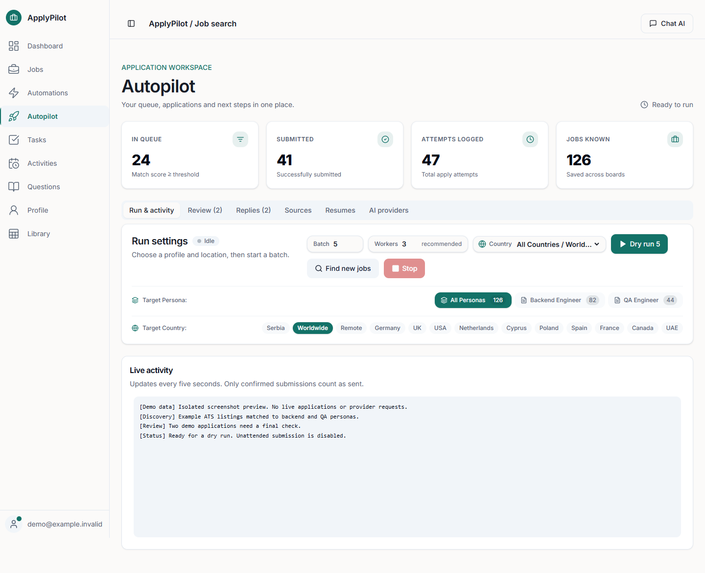
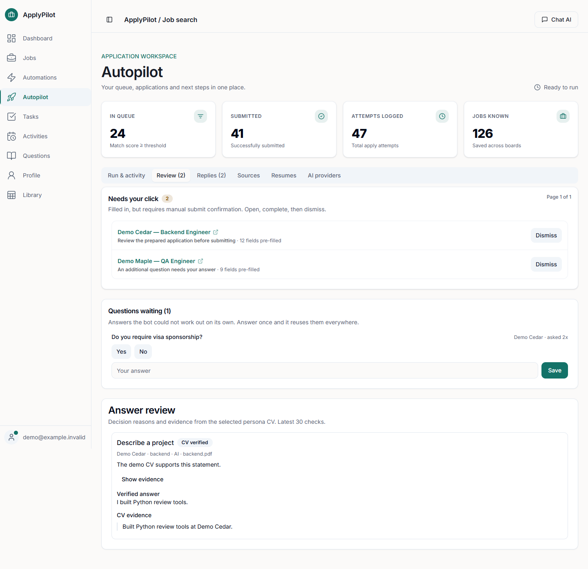
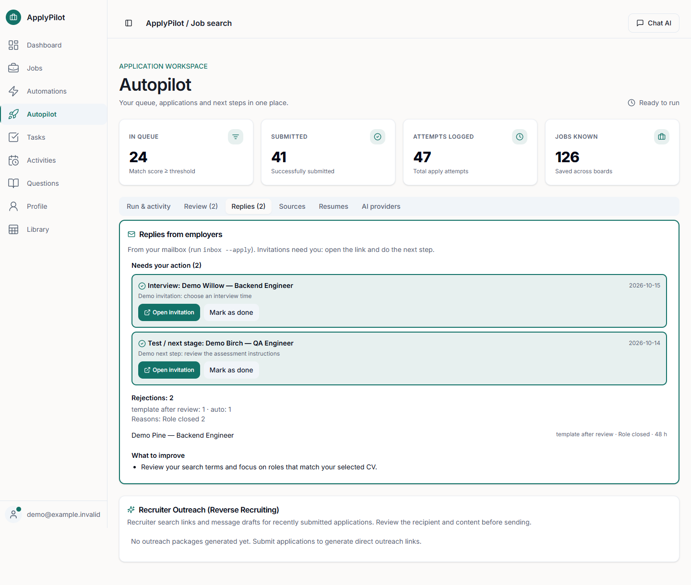
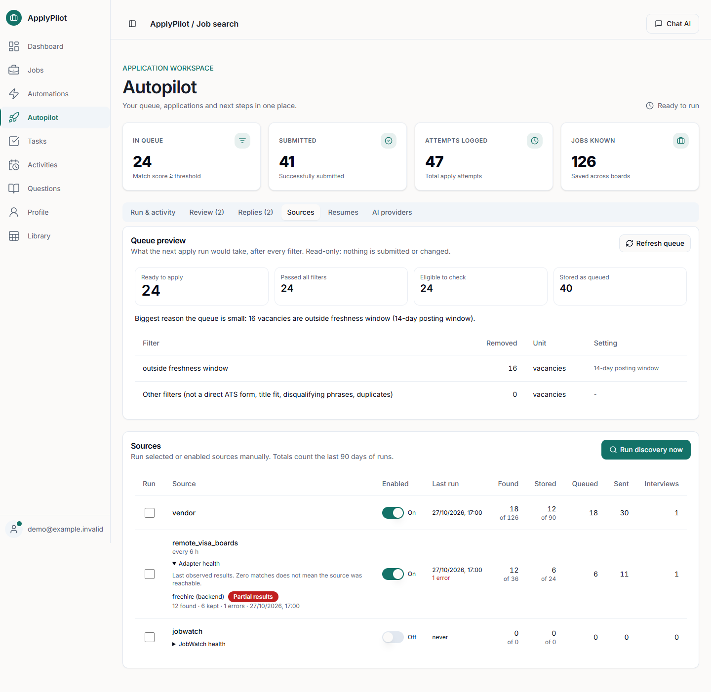
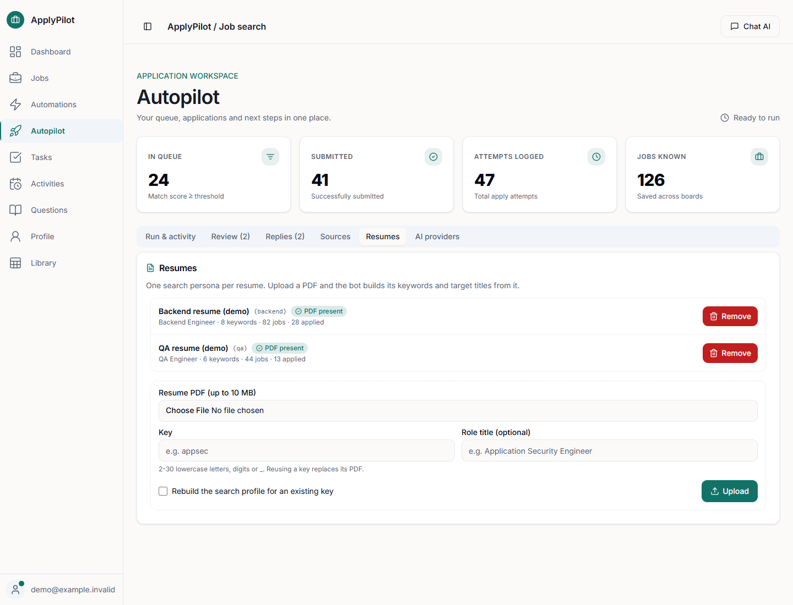
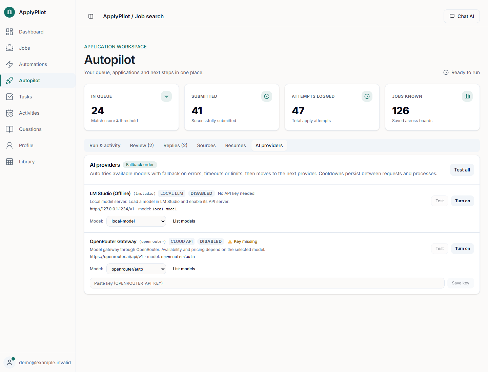
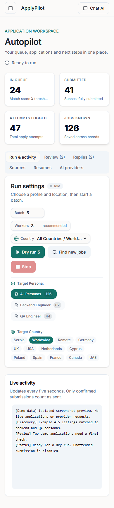

# ApplyPilot

[](https://github.com/madnessbrainsbl/applypilot/actions/workflows/ci.yml)
[](LICENSE)

**Find jobs, match them to your CV, prepare applications and track the next step — from your own machine.**



[Quick start](#quick-start-autopilot) · [Dashboard](#dashboard) · [Screenshots](#screenshots) · [Engine reference](autopilot/README.md)

A local job-search assistant in two parts, each with its own SQLite database:

- **Autopilot** (`tools/`, `autopilot/`): a Python + Playwright engine. It discovers vacancies from many sources,
  scores them against your search profile, opens the application form, fills it from your profile and CV, and
  hands the final click to you (or submits, if you switch that on). Questions it cannot answer by rules go to a
  chain of LLM providers; whatever is left lands in a queue for you.
- **Dashboard** (`src/`): a Next.js app forked from [JobSync](https://github.com/Gsync/jobsync) (MIT). It tracks
  applications and resumes, and at `/dashboard/autopilot` it controls the engine: start a run, answer pending
  questions, test and toggle LLM providers, watch the live log.

The dashboard and engine run on your machine. Discovery queries go to the search services you configure;
application data goes to the employer sites you use. Enabled AI providers can receive CV text, job descriptions,
form questions or challenge images. Local model providers are also supported.

Each user downloads the project and runs their own copy on their own machine. They add their own CVs,
profile, keys and accounts after installation; this data is excluded from Git and is not part of the source.
Dashboard accounts within one installation control that installation's shared autopilot.

## What you can do

| Workspace | What it does |
|---|---|
| **Run & activity** | Discover vacancies, choose a resume persona, filter by country or city, set batch size and parallel workers, and follow the activity log. Remote and worldwide searches have quick filters. |
| **Review** | Open applications that need your final click, review unresolved questions, and save answers for reuse. Expand answer decisions to inspect the draft, final answer and supporting CV evidence. |
| **Replies** | See interview invitations, assessments, offers and rejection summaries from your configured mailbox. Open the next step and mark it as done. Recruiter search links and outreach drafts stay available for your review. |
| **Resumes** | Upload a PDF for each profession, generate its search profile with an enabled LLM, and see whether its PDF is available. Each persona uses its own CV. |
| **Sources** | Enable sources, launch a selected search, inspect per-source counts and adapter errors or cooldowns, and preview which filters reduce the application queue. |
| **AI providers** | Enable your chosen API or CLI providers, select models, test connections and configure your own keys. Local model servers are supported. All example providers start disabled. |

The engine keeps submission confirmation, duplicate protection, per-company limits, persona-specific answer
caching and worker recovery in the application flow. A dispatched form is counted as submitted only after
confirmation is detected; unclear results need review.

### Discovery and matching

- Poll employer ATS boards, including Greenhouse, Ashby, Workable, Lever and SmartRecruiters, alongside remote-job feeds and configured aggregators.
- Search additional sources such as Hacker News hiring posts and crypto job feeds. Use the optional HealthTech/MedTech discovery and employer visa/relocation evidence filters for a focused search.
- Match titles, keywords and exclusions to the selected resume persona, then filter by location. Set `--country` or `--location` in the CLI, or use the dashboard controls.
- LinkedIn is a discovery source. Easy Apply is not used; applications go through employer ATS forms or manual review.
- Search APIs may need your own keys. Workspace integrations require your separately configured source projects and are optional.
- Discover public career pages through `jsonld_careers`, employer hosts through `findall_hosts`, and remote or sponsorship boards through `remote_visa_boards`. JobPosting JSON-LD, freshness checks and employer apply URLs keep discovery separate from submission.
- Import your own JobWatch exports or canonical snapshot for local review. JobWatch is disabled in the example configuration; cloud synchronization and upstream worker scheduling require your own separate setup. [Discovery and review guide](docs/discovery-and-review.md).

Provider fallback now retains model/provider cooldowns across processes. The optional OpenCode CLI provider supports automatic selection from its configured free-model pool; paid Go models require explicit selection and separate setup. No provider is enabled by installing ApplyPilot.

### Choose how applications are handled

| Mode | Behavior |
|---|---|
| **Dry run** | Fills a form without submitting. This is the dashboard default. |
| **Assisted review** | `--review --submit` opens the browser so you can inspect the application and press Submit yourself. |
| **Unattended** | `--submit` allows the engine to submit. In the dashboard this requires explicitly setting `apply.submit_without_review` to `true`. |

Candidate facts come from your own profile, CV and validated answers. Unknown visa/work-authorization answers
and questions the engine cannot resolve are left for you. Unresolved challenges also require manual review.

> **Responsible use.** Automated submissions can break a site's terms of service and can send applications you did
> not intend. The assisted mode (`--review --submit`) never submits by itself: you check the filled form and press Submit.
> The engine attempts checkbox challenges and audio reCAPTCHA using a configured speech API; unresolved challenges require manual review. You are responsible for every
> application sent in your name.

## Requirements

- Python 3.10+ and Google Chrome (or Playwright's Chromium)
- Node.js 24+ (dashboard only)
- Automated Python checks run on Windows and Linux; dashboard checks run on Linux. macOS has not been verified.
  Some helpers, including Chrome detection and process cleanup, contain Windows-specific paths.

## Quick start (autopilot)

```sh
git clone https://github.com/madnessbrainsbl/applypilot.git
cd applypilot

pip install -r requirements.txt
python -m playwright install chromium          # skip if you use installed Chrome

cp autopilot/config.example.json autopilot/config.json     # the CLI also creates it on first run
```

In PowerShell, use `Copy-Item` instead of `cp` if preferred. The example selects installed Chrome;
set `browser.channel` to `null` to use Playwright's downloaded Chromium.

1. Edit `autopilot/config.json`:
   - `profile`: your name, email, phone, links, `country`, `languages`, salary, notice period.
   - `apply.require_sponsorship`: set `true` or `false`. While it is `null`, the engine will not answer
     visa/work-authorization questions by itself.
   - `apply.answers`: your own answers (`open_to_relocation`, `open_to_onsite`, ...).
   - `personas`: one entry per profession you apply for (title terms, search keywords, CV path).
2. Add your CV as a persona (an LLM provider drafts the search terms from the PDF, using only what the CV says;
   without one, fill in `personas.<name>.search` by hand):

   ```sh
   python tools/autopilot.py resume add --file my-cv.pdf --name mycv --role "Backend Engineer"
   ```

3. Put credentials in `~/.config/search-work-world/secrets.env` (template: `autopilot/secrets.env.example`).
   Use the secrets file for credentials; legacy email/provider credentials in `config.json` are still accepted for compatibility.
4. Check the setup, then run:

   ```sh
   python tools/autopilot.py doctor                     # what is missing or misconfigured
   python tools/autopilot.py discover                   # collect vacancies into autopilot/jobs.db
   python tools/autopilot.py apply --dry-run --max 1    # fill one form, submit nothing
   python tools/autopilot.py apply --review --submit --max 5     # assisted mode: you press Submit
   python tools/autopilot.py status
   ```

Narrow a search or application batch to a persona and location:

```sh
python tools/autopilot.py discover --persona mycv --location germany
python tools/autopilot.py apply --persona mycv --location germany --dry-run --max 1
```

To refresh mailbox outcomes and inspect the report:

```sh
python tools/autopilot.py inbox --apply
python tools/autopilot.py outcome
```

This needs your own IMAP settings and mailbox credentials. Invitations and assessments still require you to take the next step.

`--submit` exists for unattended runs. Use it only after you have watched several `--review` runs behave correctly. Full command list and every config key: [autopilot/README.md](autopilot/README.md).

## Dashboard

```sh
npm ci
cp .env.example .env         # then set DATABASE_URL="file:./dev.db" and a random AUTH_SECRET
python -c "import sqlite3; sqlite3.connect('prisma/dev.db').close()"
npx prisma generate
npx prisma migrate deploy
npm run dev                  # http://localhost:3737
```

Create an account on first visit, then open `/dashboard/autopilot`. The page runs `python tools/autopilot.py`; set
`AUTOPILOT_PYTHON` if your interpreter is not called `python`. `docker compose up` starts the upstream JobSync image,
which does not include the autopilot page. Dashboard features and settings: [docs/jobsync-dashboard.md](docs/jobsync-dashboard.md).

## Screenshots

These captures show the current dashboard with **synthetic demo data** in an isolated installation.
Companies, counters, outcomes and resume entries are illustrative. No personal CVs, mailbox contents,
credentials or browser sessions are shown; provider connections were not tested against live services for these captures.

<details>
<summary><strong>Review applications and answer unresolved questions</strong></summary>

Open a prepared application for a final check, or answer a question once so it can be reused.



</details>

<details>
<summary><strong>Track replies and next steps</strong></summary>

Interview invitations and assessments are separated from rejection summaries.



</details>

<details>
<summary><strong>Inspect discovery sources and the queue</strong></summary>

See the last run, adapter health, selected sources and the reasons vacancies were filtered.



</details>

<details>
<summary><strong>Manage a resume for each profession</strong></summary>

Keep separate CVs and search profiles, and check whether each PDF is available.



</details>

<details>
<summary><strong>Choose AI providers and models</strong></summary>

Configure local or cloud providers. Demo providers are disabled and key fields are empty.



</details>

<details>
<summary><strong>Use the dashboard on a small screen</strong></summary>

The same run controls and location filters adapt to a mobile viewport. The engine still runs on the host machine.



</details>

## Tests

```sh
python tools/run_tests.py    # isolated example profile and temporary database
pip install -r requirements-dev.txt
python tools/run_tests.py --pytest -q   # additional isolated regression checks
npm test                     # dashboard unit tests (vitest)
npm run lint
npm run build
```

Optional browser engines and local speech recognition are listed in `requirements-browser.txt`.
Install them only when using those features; their browsers/models may require separate downloads.
The default installation continues to use Playwright and Chrome/Chromium. LinkedIn remains a search source;
applications use employer ATS forms or manual review.

## Privacy and safety

- Do not commit `autopilot/config.json`, `autopilot/resumes/`, `autopilot/jobs.db`, `autopilot/browser-state.json`
  or your secrets file. `.gitignore` covers them. See [SECURITY.md](SECURITY.md).
- Offline candidate facts require profile values or explicit answers. LLM answers are checked for selected unsupported claims; review is still necessary. It declines or leaves demographic questions
  blank and routes anything unclear to `python tools/autopilot.py qa --pending` instead of guessing.
- Review the offline answer rules (`_OFFLINE_RULES` in `tools/autopilot.py`) once, so you know what is answered
  without asking you.

## Credits and license

The dashboard is built on [JobSync](https://github.com/Gsync/jobsync) by Gsync. MIT licensed, see [LICENSE](LICENSE).
Contributions are welcome: see [CONTRIBUTING.md](CONTRIBUTING.md).

## From the author

ApplyPilot helps you search for jobs and prepare applications on the way to an interview. For help during the
interview itself, try [Talkaside](https://app.talkaside.workers.dev/): a Windows app with answer suggestions based on
your CV and the job description, live translation in 27 languages, and conversation transcription.

Talkaside is a paid application with a **5-day trial**. **ApplyPilot is free and open source.** Both tools let you
choose your own providers; any fees charged by those providers are separate.

---

**Keywords:** job search automation, job application bot, auto apply, ATS application automation, Greenhouse,
Ashby, Workable, AI cover letters, resume matching, application tracking, local job-search assistant,
self-hosted career tools, Python, Playwright.
