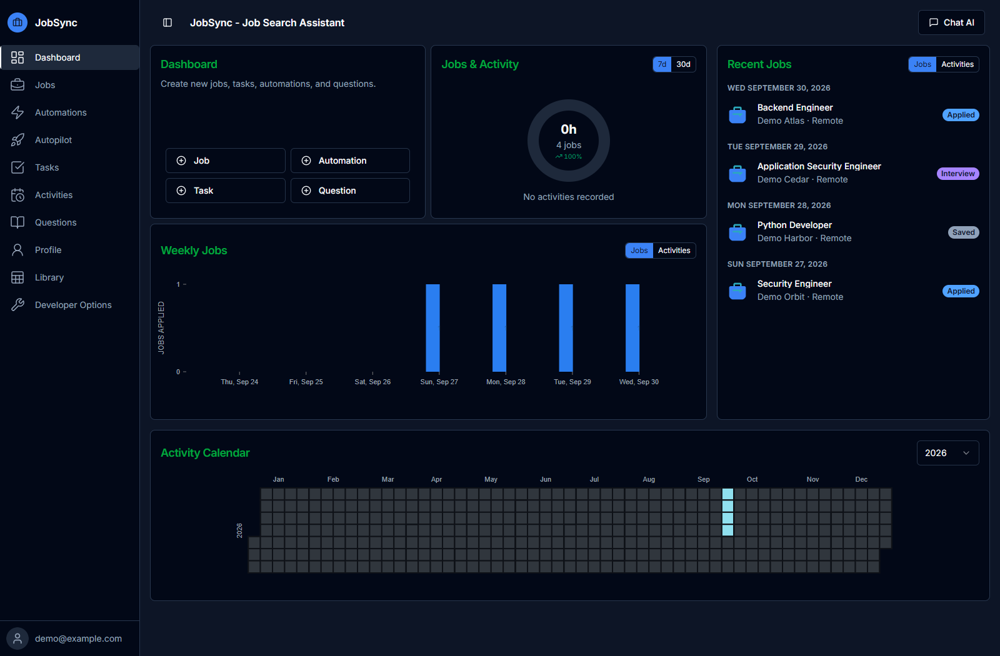
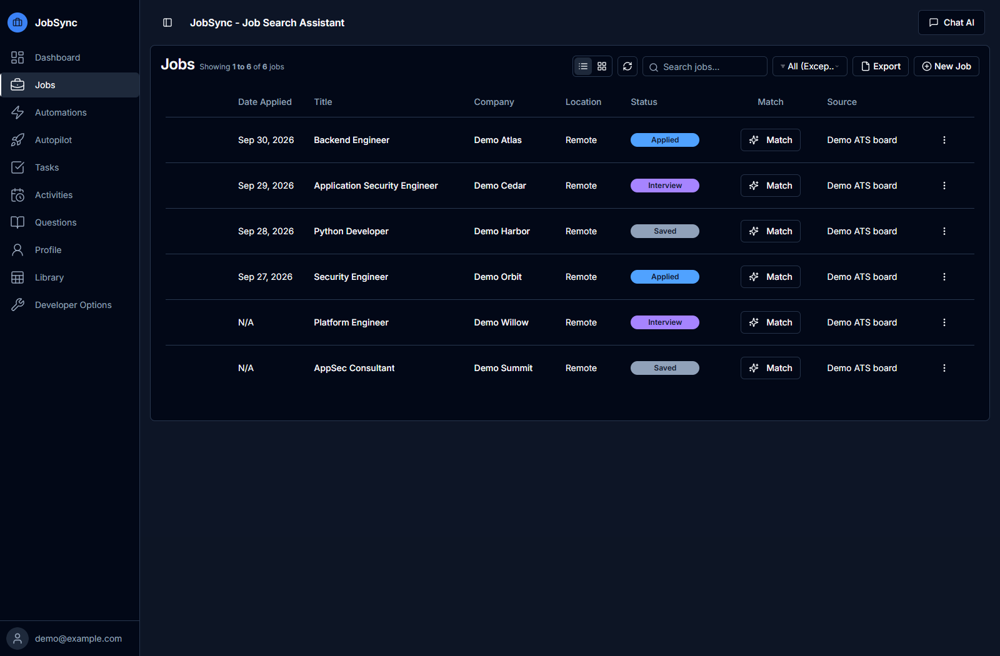
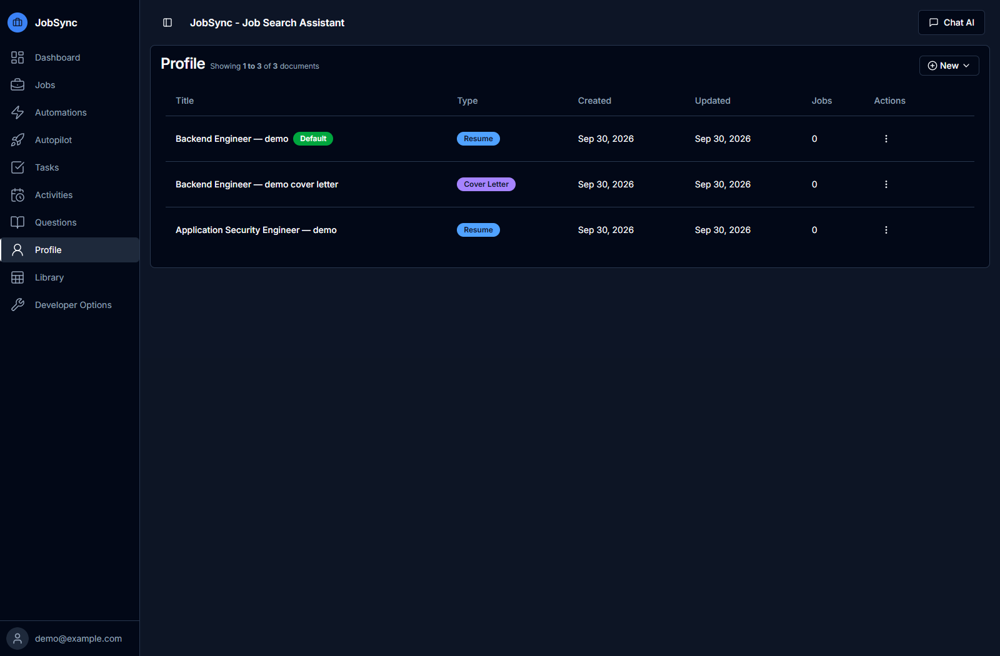
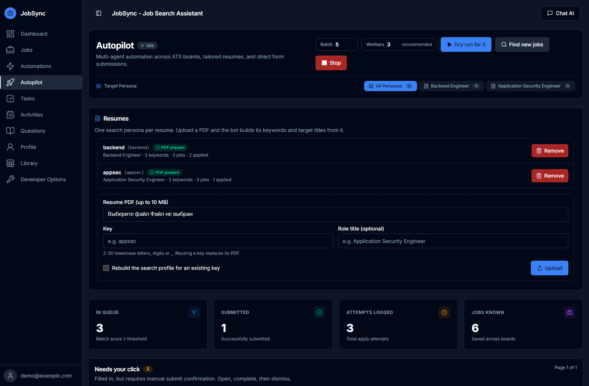
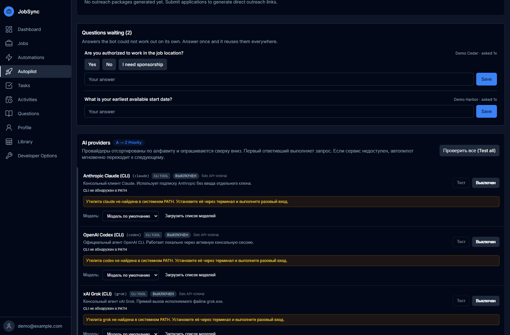
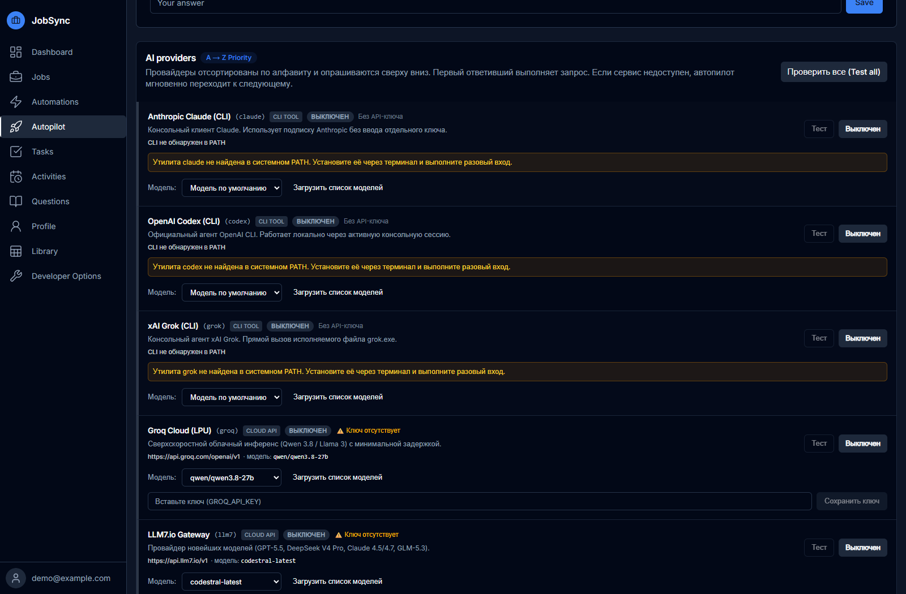

# Если нас отбирают боты, почему бы не использовать своего?

На сайте компании загружаешь резюме, а потом всё равно заполняешь имя, телефон, опыт и образование. Открываешь следующую вакансию и повторяешь то же самое. Заодно нужно помнить, куда уже откликнулся, какое резюме отправил и где осталась недозаполненная анкета.

При этом со стороны работодателя тоже может работать автоматизация: разбирать резюме, проверять поля, помогать с первичным отбором. Если компания пользуется такими инструментами, почему кандидат должен делать всю свою рутину руками?

С этой мыслью я и сделал [ApplyPilot](https://github.com/madnessbrainsbl/applypilot). Он ищет вакансии, подбирает резюме и заполняет анкеты. А я могу проверить результат и решить, отправлять ли отклик.

Проект бесплатный, с открытым кодом и лицензией MIT. Запускается на своём компьютере. Для веб-панели я взял [JobSync](https://github.com/Gsync/jobsync), поэтому на скриншотах видно его название.



> Скриншоты сняты в работающей программе на тестовых данных. Компании Demo, резюме и цифры придуманы для показа интерфейса. Реальных откликов с этого стенда не отправляли. Здесь показана ранняя версия панели; в текущей версии настройки разделены на вкладки Run & activity, Review, Replies, Resumes и AI providers.

## Сначала найти то, на что вообще стоит откликаться

В ApplyPilot можно указать нужные должности, ключевые слова, страны и условия работы. По этим настройкам бот собирает вакансии и ставит подходящие выше в очереди. Оценка здесь нужна для сортировки; предсказывать по ней приглашение на собеседование не стоит.

Он умеет искать на Greenhouse, Ashby и Workable. Это площадки, на которых компании размещают вакансии и принимают анкеты. Есть и другие источники, в том числе поиск через JobSpy и Tavily. Некоторые потребуют свой API-ключ.

LinkedIn используется для поиска. Бот пытается найти ту же позицию на сайте компании и работать уже с её анкетой. Easy Apply он не нажимает.

В панели можно вести список вакансий и отмечать, что с ними происходит: сохранил, откликнулся, дошёл до интервью. История автопилота хранится отдельно, поэтому запись в этой таблице сама по себе ещё не подтверждает отправку.



## Не отправлять одно резюме на всё подряд

Допустим, ты ищешь работу и как Backend Engineer, и как Application Security Engineer. Для этих направлений могут быть разные резюме и разные слова для поиска.

В автопилот можно добавить несколько PDF. У каждого будет свой поисковый профиль, который в настройках называется persona. По названию вакансии бот выбирает направление и связанный с ним документ. Если нужного PDF нет, отклик останавливается.

При добавлении резюме AI может предложить ключевые слова из его текста. Если AI недоступен, программа делает небольшой набор из указанного названия роли. В любом случае его стоит посмотреть и поправить: слишком широкие слова принесут лишние вакансии.

В панели также есть редактор резюме и сопроводительных писем. Документы в разделе Profile и PDF автопилота пока управляются отдельно; для заполнения анкет свой PDF нужно добавить в библиотеку Autopilot.



## Пусть бот заполняет, а я проверю

Больше всего хочется убрать повторяющееся заполнение: контакты, ссылки, загрузку файла, стандартные поля. Здесь ApplyPilot открывает форму в браузере и переносит в неё данные из профиля и резюме.

Начать можно с одной анкеты без отправки:

```powershell
python tools/autopilot.py apply --dry-run --max 1
```

Бот заполнит доступные поля и прикрепит документы. Отправлять заявку этот режим не будет.

Чтобы проверить всё в открытом браузере и нажать Submit самому, есть другой запуск:

```powershell
python tools/autopilot.py apply --review --submit --max 5
```

В этой команде `--review` оставляет последний клик человеку. Бот ждёт, пока ты проверишь анкету и отправишь её.

Автоматическая отправка тоже есть: `apply --submit` без `--review`. Но сначала стоит посмотреть, как заполняются формы на нужных сайтах. Кнопка Apply в панели по умолчанию запускает заполнение без отправки; автоподачу нужно отдельно включить в настройках.



## А если в анкете вопрос, на который бот не знает ответ?

Имя и телефон можно взять из профиля. С правом на работу, визой или датой выхода так не получится, если человек ещё не указал ответ.

Для таких случаев есть очередь вопросов. Открываешь её, отвечаешь, сохраняешь. Программа сможет использовать сохранённый ответ, когда этот вопрос встретится снова.

Для свободного текста можно подключить AI: он получает контекст резюме и вакансии. Его ответы всё равно нужно читать. Проверки в коде ловят часть неподтверждённых утверждений, но образование, опыт и право на работу требуют особенно внимательной проверки.

Формы с CAPTCHA или другими препятствиями могут потребовать ручного действия. Их тоже можно увидеть в очереди. Например, с Lever бот работает только в режиме проверки человеком.



## AI можно выбрать самому

В ApplyPilot можно подключить разные модели через API или поддерживаемые консольные программы. В панели есть выбор модели, включение и выключение провайдера, кнопка проверки подключения. Если один из настроенных провайдеров не отвечает, бот пробует следующий.

В примере конфигурации все провайдеры выключены. Нужно подключить свои ключи или настроить нужный CLI. На скриншоте ниже они тоже выключены, поэтому видны сообщения о недоступных подключениях.



Сам ApplyPilot работает локально. Но если включить облачную модель, текст резюме и вакансии уйдёт этому провайдеру. При отправке отклика документы уйдут работодателю. Расходы на платные API оплачиваются отдельно.

## Как попробовать

Проект разрабатывается на Windows. Нужны Python 3.10+, Chrome или Chromium и Node.js 24+ для панели. Установку описал в [README](../README.md#quick-start-autopilot), все команды есть в [документации автопилота](../autopilot/README.md).

После установки добавь своё резюме, заполни контакты и настрой поиск. Значения из примера нужно заменить или очистить, особенно образование, зарплату и сроки выхода. Ключи хранятся отдельно от публичного кода.

Проверить настройки и собрать первые вакансии можно так:

```powershell
python tools/autopilot.py doctor
python tools/autopilot.py discover
python tools/autopilot.py status
```

Панель открывается на [localhost:3737](http://localhost:3737). Для полного проекта используй установку из README: имеющийся Docker Compose запускает только базовую панель JobSync.

Под капотом здесь Python с Playwright для браузера и Next.js для панели. У них отдельные SQLite-базы. Несколько работников могут разбирать очередь параллельно, а ограничения на повторные отправки одной компании помогают не засыпать её одинаковыми откликами.

Каждому пользователю нужна своя установка: аккаунты внутри одной панели управляют общим автопилотом. Резюме, базы, браузерные сессии и ключи нельзя выкладывать вместе с кодом. Подробности есть в [SECURITY.md](../SECURITY.md).

Формы меняются, сайты ограничивают автоматизацию, и где-то придётся закончить анкету руками. За содержание и отправку отвечаешь ты. Для первого запуска я бы взял одно резюме и одну вакансию в `--dry-run`, а уже после проверки перешёл к `--review`.
